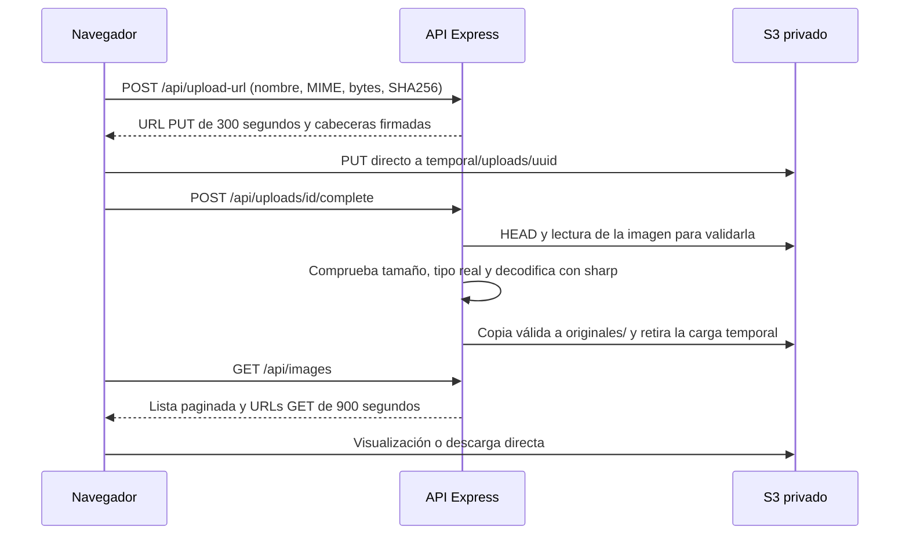

# Lumbre · Laboratorio 09

Gestor de imágenes privadas de Amazon S3. Backend Express y AWS SDK v3; frontend HTML, CSS y JavaScript; ejecución con Docker Compose. Interfaz en español con carga por arrastre, progreso, búsqueda, ordenación, vista previa, descarga y eliminación.

## Arranque local sin AWS

```powershell
docker compose -f compose.yaml -f compose.demo.yaml up -d --build
```

Abre http://localhost:3000. Este modo utiliza **LocalStack**, un emulador local, no Amazon S3. Las credenciales `test` son valores públicos de emulación sin acceso a AWS. Los archivos de la demo son efímeros y se pierden al recrear LocalStack. La demo no es una evidencia de ejecución en AWS ni garantiza que el emulador reproduzca la expiración o IAM exactamente.

## Conectar con el bucket real

1. En IAM, crea una clave nueva para `app-imagenes-user` (la clave anterior fue eliminada). Configura el perfil local: `aws configure --profile lab09-nuevo`. Nunca utilices claves raíz.
2. En S3 > bucket > Permisos > CORS, pega `docs/s3-cors.json`. No desactives el bloqueo público.
3. Opcionalmente copia `.env.example` a `.env` para cambiar región, bucket, origen o perfil. No guardes claves en ese archivo. Docker monta `%USERPROFILE%/.aws` solo para lectura en el backend.
4. Detén la demo y arranca AWS:

```powershell
docker compose -f compose.yaml -f compose.demo.yaml down
docker compose up -d --build
```

Abre http://localhost:3000. La etiqueta superior debe decir Almacenamiento en AWS. Si las credenciales no son válidas, la galería muestra un error recuperable; esa etiqueta identifica el modo, no certifica la conexión.

## Arquitectura y seguridad



La carga inicial viaja directamente a S3. La lectura posterior del backend es una validación de contenido; no es un proxy de carga. Un SHA256 firmado impide cambiar los bytes de la carga con el mismo ticket. El backend también verifica el tamaño real y decodifica la imagen antes de publicarla. Las imágenes animadas y las de más de 40 millones de píxeles se rechazan para acotar recursos.

- JPEG, PNG y WebP, tamaño estrictamente menor a 5 MiB (5 × 1024 × 1024 bytes).
- URL PUT: 300 segundos; URL GET/descarga: 900 segundos. Una operación ya iniciada puede continuar aunque el enlace venza.
- SSE-S3 AES256 en AWS; no se activa KMS ni replicación para evitar costos adicionales.
- Política IAM existente: ListBucket en el bucket; GetObject, PutObject y DeleteObject en sus objetos. CopyObject utiliza permisos GetObject sobre origen y PutObject sobre destino. No se amplían permisos administrativos.
- Solo loopback en Docker; CORS explícito para localhost:3000; CSP, Helmet, JSON limitado, rate limiting general (90/min) y de generación de cargas (15/min).
- Nombres saneados, UUID por objeto, claves de eliminación restringidas a originales/. Sin inserción de nombres de archivo mediante HTML.
- Una carga sin completar permanece en temporal/uploads/. Los tickets se conservan en memoria hasta 6 minutos: al reiniciar, no se recuperan. Limpia objetos temporales huérfanos desde la consola al terminar. Con versionado, DeleteObject crea marcadores: las versiones siguen consumiendo almacenamiento hasta la limpieza final.
- La app no incluye autenticación multiusuario, antivirus ni WAF. Es un laboratorio local; antes de publicarla deben añadirse autenticación, autorización por propietario, almacenamiento duradero de tickets, control de cuotas y escaneo. CORS no sustituye autenticación.
- No se registran secretos ni URLs firmadas en logs. No subas `.env`, `.aws`, CSV ni archivos de credenciales a Git.

## Endpoints

| Método y ruta | Función |
|---|---|
| POST /api/upload-url | Recibe filename, contentType, sizeBytes y checksum SHA256 base64; entrega uploadUrl, headers, uploadId y key |
| POST /api/uploads/:id/complete | Verifica la imagen cargada y publica en la galería |
| GET /api/images?cursor=… | Devuelve items y nextCursor, hasta 40 claves por página |
| DELETE /api/images/originales/… | Elimina lógicamente un objeto con la clave indicada |
| GET /api/config | Configuración pública sin credenciales |
| GET /health | Estado del proceso, no verifica conexión a S3 |

## Desarrollo y verificaciones

```powershell
npm ci
npm test
npm run check
npm audit --omit=dev
```

Los tests usan un almacenamiento inyectado: verifican rechazo de MIME/tamaño, discrepancias reales, contenido falso, imágenes válidas, replay de tickets, ámbito de eliminación, paginación y errores redactados. No sustituyen las pruebas de AWS.

La guía de evidencias, las seis pruebas obligatorias y respuestas de análisis están en [docs/EJERCICIO_4.md](docs/EJERCICIO_4.md). El script `npm run smoke` hace una carga, descarga y eliminación real contra el servicio que esté ejecutándose; úsalo en la demo o, conscientemente, en AWS con archivos pequeños.

## Docker y limpieza

```powershell
docker compose -f compose.yaml -f compose.demo.yaml ps
docker compose -f compose.yaml -f compose.demo.yaml logs --tail 30 app
docker compose -f compose.yaml -f compose.demo.yaml down
```

Después de las evidencias reales: desactiva/elimina la clave, vacía el bucket incluyendo versiones y marcadores, elimina el bucket y elimina el usuario del laboratorio. Detener Docker no elimina recursos de AWS. No se ejecuta limpieza destructiva automática.

## Referencias

- [S3 con AWS SDK v3](https://docs.aws.amazon.com/sdk-for-javascript/v3/developer-guide/javascript_s3_code_examples.html)
- [CORS de S3](https://docs.aws.amazon.com/AmazonS3/latest/userguide/ManageCorsUsing.html)
- [URLs prefirmadas](https://docs.aws.amazon.com/AmazonS3/latest/userguide/using-presigned-url.html)

Tipografía Manrope bajo SIL Open Font License, incluida en frontend/fonts/LICENSE.txt.
